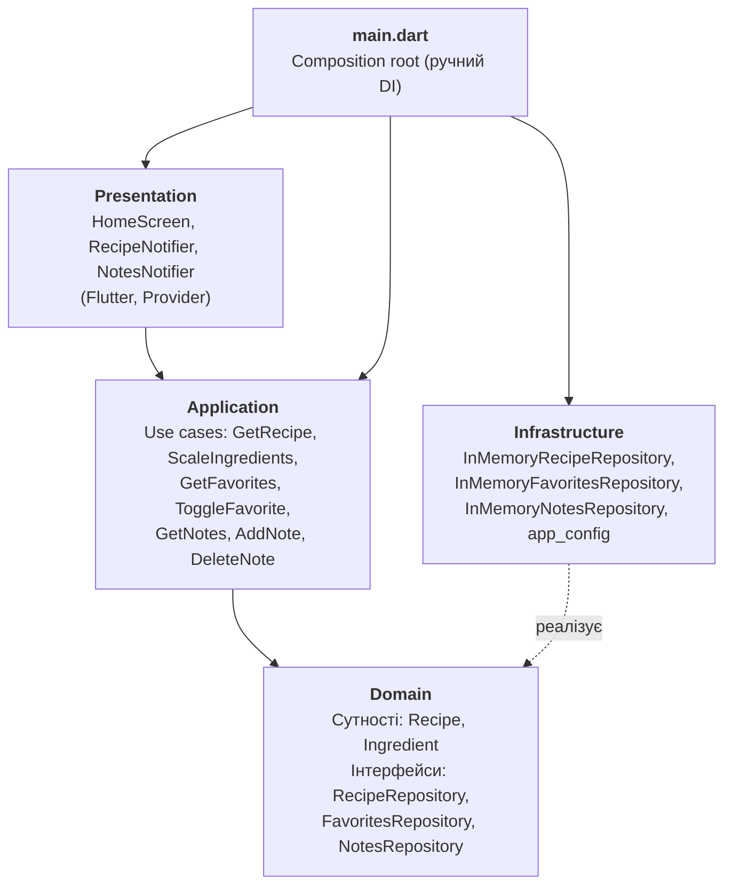

# Recipe App

Flutter-застосунок для перегляду рецепта «Student food» (бутерброд зі студентської кухні): інгредієнти, кроки приготування, нотатки та улюблене. Побудований за принципами Clean Architecture.

## Можливості
- перегляд інгредієнтів із автоматичним перерахунком за кількістю порцій (від 1 до 12)
- додавання та видалення власних нотаток до рецепта
- позначення страви як улюбленої з лічильником у верхній панелі
- перемикання між вкладками «Інгредієнти» та «Кроки»

## Архітектура

Застосунок поділено на чотири шари. Залежності спрямовані всередину, до шару Domain: Domain не залежить ні від чого, Infrastructure реалізує його інтерфейси (інверсія залежностей).



| Шар | Відповідальність | Залежить від |
|---|---|---|
| Domain | Сутності та абстрактні інтерфейси репозиторіїв | — |
| Application | Сценарії використання (бізнес-логіка застосунку) | Domain |
| Infrastructure | Реалізації репозиторіїв (зберігання в пам'яті), конфігурація | Domain |
| Presentation | UI та стан екрана (`ChangeNotifier`) | Application, Domain |

`main.dart` є точкою збирання залежностей (Dependency Injection): створює репозиторії, передає їх у use cases, а use cases у нотифікатори, які надає `MultiProvider`. Екран не імпортує нічого з Infrastructure.

## Структура каталогів

```
lib/
├── main.dart                       # composition root, ручний DI
├── domain/
│   ├── entities/                   # Recipe, Ingredient
│   └── repositories/               # абстрактні інтерфейси репозиторіїв
├── application/
│   └── use_cases/                  # сценарії використання
├── infrastructure/
│   ├── config/app_config.dart      # конфігурація (тип сховища, назва рецепта)
│   └── repositories/               # in-memory реалізації репозиторіїв
└── presentation/
    ├── notifiers/                  # RecipeNotifier, NotesNotifier
    └── screens/                    # HomeScreen
test/
└── widget_test.dart                # віджет- та юніт-тести
```

## Гілки (Git Flow)
- `main` — стабільний код, релізи позначаються тегами (`v1.0.0`)
- `develop` — інтеграційна гілка, куди зливаються feature-гілки
- `feature/domain-layer` — сутності та інтерфейси репозиторіїв
- `feature/application-layer` — use cases
- `feature/infrastructure-layer` — реалізації репозиторіїв та конфігурація
- `feature/presentation-layer` — перенесення UI в шар Presentation і DI
- `chore/*` — короткі службові гілки (конфігурація)

Злиття виконуються з `--no-ff`, повідомлення комітів відповідають Conventional Commits.

## Збірка та запуск

Потрібен Flutter SDK (Dart `^3.13.3`).

```bash
flutter pub get      # встановити залежності
flutter analyze      # статичний аналіз коду
flutter test         # запустити тести
flutter run          # запустити застосунок (наприклад, flutter run -d windows)
```
